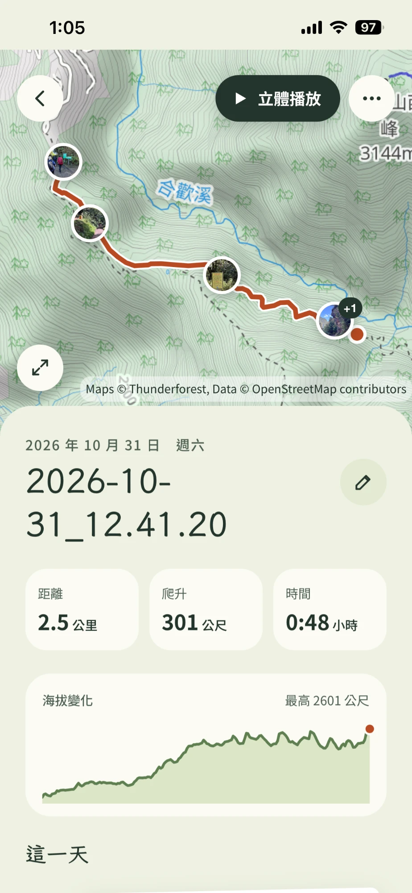
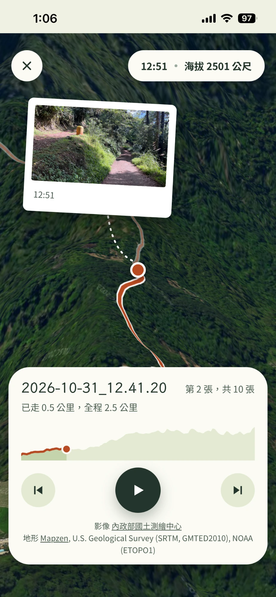

<div align="center">

# 登山回憶

**把走過的山，變成一篇可以翻閱的日誌**

匯入登山 App 記錄的 GPX 檔和當天的照片，照片會依拍攝時間放到路線上，<br>
還能在真實空拍影像的立體地形上，把整趟路重走一次。

[**打開 App**](https://tinggeorge.github.io/outgoing-map/)　·　免費　·　不用帳號　·　資料只留在你的裝置

<br>






</div>

## 特色

- **照片自動放上路線**：依拍攝時間對上軌跡，不需要照片本身有定位。
- **立體播放**：貼著國土測繪中心空拍影像的 3D 地形，沿路線飛行，飛到照片拍攝的位置會停下來。
- **一篇完整的日誌**：距離、爬升、時間、海拔變化，沿途的山頭與景點自動標出，還可以寫日記和照片說明。
- **像 App 一樣用**：這是網頁 App（PWA），加到手機主畫面就能全螢幕開啟，離線也看得到存好的回憶。
- **隱私**：沒有後端，回憶和照片不會上傳到任何伺服器。
- **開放原始碼**：MIT 授權。

## 怎麼用

1. 第一次開啟時，照著教學到 Thunderforest 免費領一把地圖鑰匙（API Key），貼上就好。
2. 回到家，按「新的回憶」，選當天登山 App 匯出的 GPX 檔和照片。要最完整的結果，GPX 檔要是登山 App 當天實際記錄的，不是網路下載或自己畫的路線。
3. 打開日誌看路線、照片和海拔，寫幾句日記，或按「立體播放」重走一次。

需要的只有一把免費的 Thunderforest 鑰匙，不用帳號、不用付費。

## 隱私

回憶、照片和鑰匙都只存在你這台裝置的瀏覽器裡，不會上傳到任何伺服器。地圖鑰匙只在載入地圖時由裝置直接交給 Thunderforest。要備份或換手機，在每篇回憶的選單裡匯出，再到設定匯入。

## 開發

需要 Node 20.19 以上。

| 指令 | 用途 |
|---|---|
| `npm run dev` | 開發伺服器，預設 5173；換埠用 `npm run dev -- --port 5180` |
| `node scripts/build-poi.mjs` | 由 `data/poi.sqlite` 重新產生 `public/poi.json`（需要 `sqlite3` 指令） |
| `npm run build` / `npm run preview` | 型別檢查後建置到 `dist/`；預覽建置結果 |
| `npm run typecheck` | TypeScript 檢查 |
| `npm run test` | 單元測試（Vitest，happy-dom） |
| `npm run e2e` | 端對端測試（Playwright，chromium 與 webkit，390×844）；換埠用 `E2E_PORT=5190 npm run e2e` |
| `npm run build && npx playwright test -c playwright.build.config.ts` | 針對建置結果（以 `/outgoing-map/` 子路徑提供，埠 5193；`E2E_DIST=<資料夾>` 換成別的建置），chromium 與 webkit：manifest、Service Worker 與離線、離線字型、更新到新版（測試自己再建一次到 `node_modules/.cache/update-build`，用隨機的埠提供）、正式版的地圖（有鑰匙時） |

網址用 hash 路由：`#/welcome` 鑰匙教學、`#/` 首頁、`#/new` 新的回憶、`#/trip/:id` 日誌、`#/trip/:id/fly` 立體播放、`#/settings` 設定。裝置上沒有金鑰時一律導到 `#/welcome`。

| 資料夾 | 負責 |
|---|---|
| `src/types.ts` | 共用資料模型 |
| `src/core/` | 純邏輯：GPX 解析、距離與爬升、路線、照片依時間放上軌跡、時間軸、海拔剖面 |
| `src/poi/` | 景點資料載入、沿路線的景點查詢 |
| `src/storage/` | IndexedDB（行程、軌跡、照片資料與檔案）、照片匯入、行程匯出與匯入（zip） |
| `src/key/` | Thunderforest 金鑰的儲存與驗證 |
| `src/map/` | 圖磚網址、來源標示、平面與立體地圖的 MapLibre 樣式；`maplibre.ts` 載入 MapLibre |
| `src/ui/` | 設計 token、共用元件、圖示、日期與數字格式 |
| `src/pwa/` | 加入主畫面提示、持久儲存 |
| `src/screens/<畫面>/` | welcome、home、new-trip、journal、flyover、settings |
| `tests/fixtures/` | 合歡北峰 GPX（有與沒有時間）、4 張帶 EXIF 的照片 |

模組之間的約定：

- 時間一律是 UTC 毫秒。GPX 的時間是 UTC。照片的 `DateTimeOriginal` 是當地時間，有 `OffsetTimeOriginal` 就用它，否則當成 `+08:00`；只在 `core.exifTimeToEpoch` 換算。用 exifr 讀時要加 `reviveValues: false`，拿原始字串。
- 照片對位：有 GPX 時，拍攝時間落在軌跡時間前後 30 分鐘內就依時間內插到軌跡上（`'track'`）；不然用照片自己的 GPS（`'exif'`）；都沒有就是 `'none'`。
- 沒有 GPX 時，路線由照片的 GPS 依時間連成，`Route.source` 是 `'photos'`，畫面要說「路線由照片位置連成，匯入 GPX 會更準」。
- `storage` 在存軌跡、加或刪照片後，自己重算行程的日期、統計、照片數與每張照片的對位。
- 金鑰只存在 `localStorage`，不進匯出檔。`.env` 裡的 `THUNDERFOREST_API_KEY` 只給端對端測試用（`process.env.THUNDERFOREST_API_KEY`，沒有就跳過），不可印出、寫進檔案或打包；Playwright 已關閉 trace、截圖與錄影。

### 模組的實際行為

- storage：`TEXT_LIMITS`：標題去掉頭尾空白後最多 80 個字元，日記最多 100,000、照片說明最多 2,000、檔名最多 255（UTF-16 字元，不會切斷 emoji）；`createTrip`、`updateTrip`、`updatePhoto`、`importTrip` 一律照這個截斷，不會丟錯。日記與說明不去空白。
- storage：照片看檔案開頭的位元組判斷，只收 JPEG、PNG、GIF、WebP、TIFF、HEIC/HEIF/AVIF（`ftyp` 品牌 heic、heix、heim、heis、hevc、hevx、mif1、msf1、avif）；其他一律是「這不是照片檔」，不看副檔名，也不先解碼。
- storage：`importTrip` 的上限（`IMPORT_LIMITS`）：檔案 768 MB、zip 內最多 2,001 個項目、單一項目解壓後 64 MB、總共 1 GB（先檢查 zip 目錄裡宣告的大小，再以串流解壓並計算實際產生的位元組，項目超過宣告大小或單項上限、或總量超過上限就立刻停止並拒絕，訊息「這個匯出檔太大，無法匯入」）、軌跡最多 500,000 點。只解出 `manifest.json` 與 `photos/<id>.jpg`，其他路徑（含 `..`、絕對路徑）忽略。manifest 的每個欄位與型別都會檢查，不對就是「這個檔案不是登山回憶的匯出檔」。
- storage：`listTrips` 依 `startAt`（沒有就 `createdAt`）新到舊；`listPhotos` 依 `takenAt` 舊到新，沒有時間的排最後。
- storage：同一趟行程裡，內容相同的照片（原始檔 SHA-256 相同）不會重複加入，會出現在 `failed`。`failed[].reason` 是可以直接顯示的中文句子（`PHOTO_FAILURE`：已加入過、HEIC 無法開啟、不是照片檔、無法讀取）。`onProgress(done, total)` 每處理完一個檔案呼叫一次，失敗的也算。
- storage：行程沒有封面或封面被刪時，自動用 `listPhotos` 的第一張當封面。
- storage：`saveTrack`、`addPhotos`、`deletePhoto`、`importTrip` 之後會自動重算 `hasTrack`、`stats`、`startAt`/`endAt`、`photoCount`、封面與每張照片的 `placement`；畫面在這些呼叫之後要重新 `getTrip` / `listPhotos`。路線沒有點時 `stats` 是 `null`。`saveTrack(id, [])` 會移除軌跡。
- storage：資料庫版本 3 在從版本 1 或 2 升級時對每篇已存的回憶重算一次（同 `saveTrack` 之後，但不改 `updatedAt`），舊的回憶不用重新匯入；某一篇的資料壞掉時跳過它（`console.warn` 只記回憶的 id 與錯誤），其他篇照樣重算。
- 日誌：路線沒有時間、照片有時間時，「時間」格改成一行「照片拍攝於 09:12 到 13:40」（頭尾同一分鐘就只寫一個時間）。立體播放只在顯示照片時顯示那張照片的時間。新的回憶選好檔案後，遇到 GPX 時間不可信會顯示「這個 GPX 檔的時間和照片的拍攝時間對不上，會改用照片的時間來排列。」，照片的說明也改成沒有位置資訊的照片放不上去（GPX 沒有時間時也一樣）。
- storage：丟出的錯誤都是 `Error`，`message` 是可以直接顯示的中文（找不到這篇回憶、找不到這張照片、裝置的儲存空間不足…、無法存取裝置上的資料…、登山回憶已在另一個分頁更新…）。`deleteTrip` / `deletePhoto` 對不存在的 id 不會出錯。
- storage：`getPhotoUrl` 每次回傳新的 object URL，用完要 `URL.revokeObjectURL`（例如在 effect 的 cleanup）。`Photo.width`/`height` 是轉正後、長邊最多 2048 的尺寸；縮圖長邊最多 480。
- storage：`exportTrip` 回傳 zip `Blob`，建議檔名 `${title}-${yyyy-mm-dd}.hiking.zip`（日期用 `startAt`，沒有就 `createdAt`；`/\:*?"<>|` 換成 `-`）。`importTrip` 一律給新的 id，匯入兩次會得到兩趟獨立的行程；檔案不對時丟出的 `message` 可直接顯示。
- storage 需要安全環境（https 或 localhost）。
- core：`parseGpx` 失敗時丟出的 `message` 可直接顯示（這個檔案不是有效的 GPX、GPX 裡沒有任何定位點；KML、KMZ、TCX、FIT 檔是「這是 KML 檔，請從登山 App 匯出 GPX 檔」之類）。`parseGpx` 保留檔案裡的順序；`buildRoute` 在每個點都有時間且順序亂掉時依時間（穩定）重排，只有部分點有時間時維持檔案順序、把倒退的時間設成 null。
- core：GPX 的時間不可信：有照片有拍攝時間，但沒有任何一張落在軌跡時間前後 30 分鐘內（例如網路下載或用 gpx.studio 畫的路線，時間是假的），`buildRoute` 就把軌跡的時間全部當成沒有，和沒有 `<time>` 的 GPX 走同一條路（`core.trackTimeTrusted` 是唯一的判斷）。所以日期、開始與結束時間都來自照片，沒有時長、景點經過時間與立體播放飛行中的時間。
- core：斷點有兩種，都不算進距離與爬升。單一一跳：相鄰兩個有時間的點相距至少 1 公里（`GAP_MIN_M`），換算速度超過每小時 12 公里（`GAP_MIN_SPEED_KMH`）或時間沒有前進，算是記錄暫停。連續行車：連續幾段每一段都超過每小時 25 公里（`GAP_RUN_SPEED_KMH`），合計至少 1 公里（例如同一個檔案裡開車換登山口）；但如果這些連續行車段加起來佔了整條路線一半以上的時間，就當成整趟是騎車或開車的紀錄，不套用連續行車斷點（單一一跳仍然算），所以單車、越野跑或純開車的檔案保留完整距離。斷點內的點會從路線丟掉，讓斷點成為單一線段，`RoutePoint.distanceM` 在斷點兩側相同。`isRouteGap(a, b)` 對斷點兩側的兩個路線點為 true，地圖、海拔剖面與立體播放都在這裡把線斷開。沒有時間的路線不會有斷點。`durationMs` 仍是頭尾時間差。`buildRoute(track, photos)` 回傳的 `Route` 當成不可變。`routeStats` 的爬升用 5 公尺的遲滯門檻。`buildTimeline` 已排好順序，沒有時間或放不上路線的照片在最後；沒有時間的路線依距離排，同一個距離依種類（出發、景點、照片、終點）再依時間，所以出發一定在最前、終點一定在最後。依照片 GPS 放上路線（`'exif'`）時，有拍攝時間的照片依時間排，`routeDistanceM` 不會倒退，在這個條件下取每張照片到路線的距離總和最小的位置（動態規劃，位置是路線每 10 公尺取一點 `ORDER_STEP_M`，最多 20,000 點 `MAX_ORDER_SAMPLES`，照片數 × 點數也不超過 4,000,000（`MAX_ORDER_CELLS`，手機上約 8 MB），超過就加大間隔；照片自己的最近點不違反順序時直接用最近點），所以環狀或往返路線上，回程拍的照片不會跑到去程，連拍時 GPS 飄移也不會把後面的照片推到終點。同一秒拍的照片依各自最近點的位置排，檔案順序不影響結果。沒有時間的照片、以及由照片連成的路線，仍放在最近的點。照片離路線不超過 150 公尺（`SNAP_TO_ROUTE_M`）時，`placement` 的 lat/lon/ele 是路線上的那一點，並標記 `onRoute: true`，照片檢視與建立完成的統計都說「依照片的位置放上路線」；更遠就保留照片自己的座標，照片檢視與統計（有這種照片時才多一列）都說「依照片的位置，離路線超過 150 公尺」。`elevationProfile` 在路線沒有海拔時回傳 `null`。
- poi：`poisAlongRoute(route)` 是 async（會先載入 `poi.json`，載入失敗會 reject，下次呼叫會重試）。往返路線上同一個景點只列一次。多數非山頂的景點 `ele` 是 `null`。種類的中文：`peak` 山頂、`trailhead` 登山口、`hut` 山屋、`shelter` 避難小屋、`campsite` 營地、`viewpoint` 觀景點、`water` 水源、`waterfall` 瀑布、`lake` 湖泊、`hotspring` 溫泉。型別裡的 `other_hiking`，以及整個名稱只是通用字詞（例如「涼亭」「水源」「候車亭」「司令台」「正門」「beach」）、通用字詞前後只加編號（「2號涼亭」「涼亭1」「第二候車亭」，前後的純數字只看一到兩位，所以「2850營地」保留）或純數字、類似十六進位代碼的項目，在產生 `poi.json` 時就濾掉了，不會出現。
- key：`validateKey` 對格式不對的字串不發請求直接回 `'invalid'`；瀏覽器分不出「金鑰被拒絕」和「額度用完」，兩者都會讓圖磚載入失敗。
- pwa：`<InstallHint />` 不需要 props，自己決定要不要顯示；`requestPersistentStorage()` 不會丟錯。
- map：地圖一律用 `loadMapLibre()` 載入（只載一次，連同 CSS 與 worker 網址）；地圖容器加上 `mapContainer` class，它會鋪滿最近一個有定位的父層（`position: absolute; inset: 0`，蓋過 MapLibre 的 `position: relative`），父層自己決定大小。
- 路由：`parseRoute` 不會丟錯，壞掉的跳脫（例如 `#/trip/%`）是 not-found，回到首頁。`guardBack(onBack)` 攔住瀏覽器的上一頁：在歷史裡放一個守門的項目，每按一次上一頁都呼叫 `onBack` 並重新放回去，直到呼叫它回傳的 `release(then?)`（拿掉守門項目後再執行 `then`）；在守門時呼叫 `goBack` 會先自己 release 再離開。同時只有一個守門，在 StrictMode 下 release 後馬上重新守門也只會有一個項目。
- 路由：`goBack(fallback)` 在 App 內有上一頁時等於瀏覽器的上一頁，從外部連結直接打開時改成換到 `fallback`。畫面的返回鈕都用它；要回到上一個畫面的操作不要用 `navigate` 往前推一頁。
- 用詞：一趟紀錄叫「回憶」（量詞「篇」），檔案叫「GPX 檔」，地圖上的線叫「路線」，Thunderforest 的 API Key 叫「鑰匙」。
- 畫面除了 welcome 與 home 都是延遲載入；載入失敗（例如新版 Service Worker 接手後還開著的舊頁面要舊的 chunk）時，連線中會自動重新載入一次（`sessionStorage` 記號防止重複重載）；離線或已重載過仍失敗就顯示重新載入的畫面，重新載入就是新版。Service Worker 預先快取所有 chunk，所以離線也打得開。
- 字型：Google Fonts 的樣式表加了 `crossorigin`，WebKit 才會讓字型檔經過 Service Worker（不加的話 WebKit 完全不經過，`google-fonts-files` 不會出現）。第一次開啟時 Service Worker 還沒接手，`keepFontsOffline()`（在 `App.tsx` 呼叫）會在接手後把已經載入的字型檔再抓一次放進快取。離線時只有看過的字有手寫字型，其他字照字型堆疊退回。
- 測試金鑰的規則照上面 `.env` 的那一條。旅程測試 `tests/e2e/journey.spec.ts` 用真的鑰匙走完整個 App；設 `JOURNEY_SHOTS=<資料夾>` 會存下每個畫面的截圖。

## 之前的 iPhone 原生版

原生 SwiftUI 版停在 `swift-final` 標籤，連同把魯地圖轉成離線圖磚與景點資料的工具。需要時可以取出：

```bash
git checkout swift-final
```

## 授權

程式碼採 MIT 授權，見 `LICENSE`。

`data/poi.sqlite` 與由它產生的景點資料 © OpenStreetMap contributors，採 ODbL 授權，整理自 Rudy Chung 的魯地圖 MOI.OSM Taiwan TOPO (https://rudymap.tw)。

地圖圖磚與影像屬於各自的提供者（Thunderforest、OpenStreetMap contributors、內政部國土測繪中心，以及地形資料來源），不在本授權範圍內。
